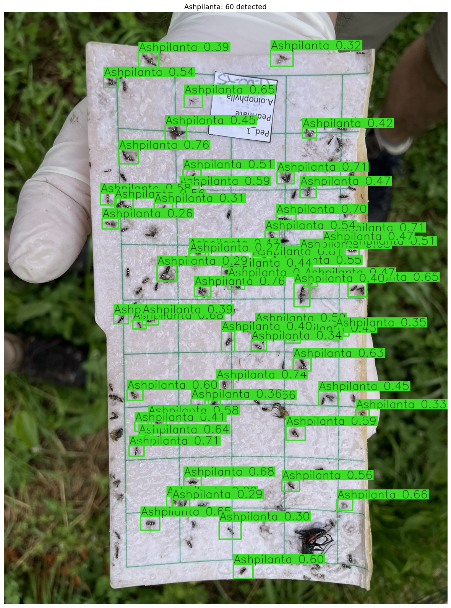
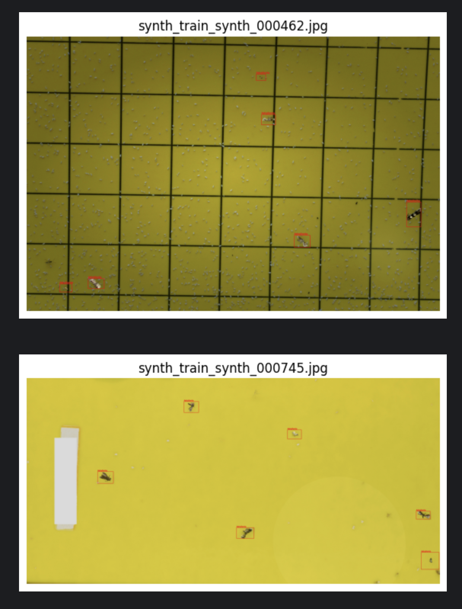

# Few-Shot Detection of *Aspilanta* on Yellow Sticky Traps

[](https://github.com/Nawfal-AI/aspilanta-fewshot-detection/actions/workflows/ci.yml)
[](LICENSE)
[](https://www.python.org/)

MSc research project at Università della Svizzera italiana (USI), MSc Artificial Intelligence, 2026.  

Training a pest detector normally takes thousands of labelled examples. For a rare or newly monitored species you do not have them. For *Aspilanta*, this project had **55 real photographs in total** - most of them close-up specimen shots rather than the cluttered trap images the detector must actually work on.

This repository is the answer to how far a detector can be pushed under that constraint, and - as much as anything - to what it takes to make the answer trustworthy rather than merely optimistic.

**Headline result:** AP@50 = **0.981** for *Aspilanta* on the target-domain validation set, from 44 usable cutouts and no additional real data collection.

> **Read it with this caveat.** That validation set is mostly synthetic, so part of the number measures the detector recognising the generator's own output. On the 11 real close-up photographs the gain from synthetic training data is 0.015 AP@50, not 0.901. The [Results](#results) section covers this in full.

---

## The method

One technique from each of the three few-shot object detection families, because none of them solves the problem alone:

| Family | Technique | What it contributes |
|---|---|---|
| **Data-oriented** | Copy-paste compositing (generator v7) | 44 cutouts → 2,000 images, 9,211 instances |
| **Model-oriented** | YOLOv8s staged transfer, trainable backbone | Turns those images into a detector |
| **Algorithm-oriented** | Frozen CLIP few-shot prototype filter | Optional re-scoring - **off by default**, see below |

A data-oriented method manufactures labelled examples but yields images, not a detector. A model-oriented method uses labels more efficiently, but efficiency is not creation. An algorithm-oriented method classifies from a handful of references and does it well, but it classifies regions and cannot find them.

---

## Quick start

```bash
pip install -e .
```

```python
from aspilanta import AspilantaDetector

detector = AspilantaDetector(weights="path/to/best.pt")
annotated, detections, counts = detector.detect("trap_photo.jpg")
print(counts["aspilanta_count"])
```

> **Counting is not validated.** No annotated real trap photographs exist for this species, so count accuracy has only been measured on synthetic images. Treat the count as a detection tally, not a verified population estimate.

Or from the command line:

```bash
python scripts/detect.py --image trap_photo.jpg
python scripts/detect.py --image field_photos/ --out-dir results/
```

---

## Results

### Detection


*Aspilanta detections on a real field trap image (Stage 2 model, single-pass inference).*

| Model | Validation set | mAP@50 | mAP@50-95 | AP<sub>Asp</sub>@50 | AP<sub>Asp</sub>@50-95 |
|---|---|---|---|---|---|
| Stage 1 (3-class base) | Three-class split | 0.868 | 0.378 | - | - |
| **Stage 2 (proposed)** | Mixed target-domain | **0.981** | **0.827** | **0.981** | **0.827** |
| Stage 2 (proposed) | Real-only subset (n=11) | 0.995 | 0.609 | 0.995 | 0.609 |
| Stage 2-F (frozen, ablation) | Mixed target-domain | 0.453 | 0.258 | 0.906 | 0.516 |

Per-class breakdown of the proposed model on the four-class split, confirming the base classes survive fine-tuning:

| Class | Instances | AP@50 | AP@50-95 |
|---|---|---|---|
| MP (*Macrolophus pygmaeus*) | 237 | 0.849 | 0.346 |
| NT (*Nesidiocoris tenuis*) | 127 | 0.976 | 0.482 |
| WF (Whitefly) | 823 | 0.787 | 0.303 |
| **Aspilanta** | 1,629 | **0.981** | **0.826** |

The zero-shot diagnostic is the control: the three-class base detector produced 8,299 detections on trap images containing *Aspilanta*, **none of them correct by construction**, because it has no output for the class. The domain gap is real, not assumed.

### Synthetic training data


*Copy-paste composited training images from generator v7 - 44 cutouts scaled to 2,000 images and 9,211 instances.*

### Deployment pipeline

| Pipeline | Precision | Recall | F1 |
|---|---|---|---|
| **Single-pass, no filter** | **0.931** | **0.801** | **0.861** |
| Single-pass + CLIP filter | 0.936 | 0.675 | 0.785 |
| Tiled inference | 0.095 | 0.013 | 0.023 |

Both refinements make things worse, and both are off by default because of it. Tiling fails on domain mismatch - the detector was trained on whole images resized to 640 px, so a native-resolution crop presents insects at a scale it has never seen. The CLIP filter buys +0.005 precision for −0.126 recall, because it is applied to every detection rather than only the uncertain ones. Section 11.3 recovers part of it with [selective filtering](docs/results.md#selective-clip-filtering).

### Cross-family baselines

| Baseline | Family | Result |
|---|---|---|
| OWL-ViT (text prompts) | Open-vocabulary | F1 = 0.382 |
| OWL-ViT (image-guided) | Open-vocabulary | recall < 0.02 |
| TFA | Model-oriented | AP@50 = 0.388 |
| Prototypical network | Algorithm-oriented | ROC-AUC > 0.996 (crop classification only) |

---

## What the ablations contradicted

Nine ablations, and three of them refused to support the design they were meant to confirm. They are reported here because a result that only confirms its own hypotheses is the less informative kind.

| Component | Effect on real-image AP@50 | Verdict |
|---|---|---|
| Pad-aware placement | **−0.269** | Strongly supported - the largest compositing effect |
| Poisson blending | −0.039 | Supported |
| ImageNet initialisation | −0.868 (the model does not train at all) | Decisively supported |
| YOLOv8s over YOLOv8n | −0.088 three-class mAP@50 | Supported |
| Synthetic data | −0.015 on real images, −0.901 on the mixed set | Weakly supported - see the confound below |
| YOLO copy-paste augmentation | −0.029, within noise at n=11 | **Not supported** |
| Distractor insects | **+0.026** - removing them *improved* real-image AP | **Refuted** |
| Frozen backbone | Freezing costs −0.075 AP@50, −0.311 AP@50-95 | **Changed the method** |
| Staged transfer chain | Comparable either way | **Contributes nothing measurable** |

The backbone result changed the proposed method. Freezing is standard few-shot practice - with few novel examples a trainable backbone overfits - but by the time fine-tuning starts the generator has already supplied 2,000 images, so the regime the freeze protects against no longer exists.

**The confound worth knowing about.** On the 11 real close-up photographs, a detector trained with *no synthetic data at all* scores 0.926 AP@50 against 0.941 for the configuration it was run against - a gap of 0.015. The mixed validation set overstates the value of synthetic data, because it is partly measuring the detector's ability to recognise the generator's own output. The claim this project supports is therefore qualified: careful synthetic compositing can substitute for large-scale real data collection, but only part of the evidence survives closer inspection.

---

## Repository layout

```
├── src/aspilanta/          The package
│   ├── config.py           All settings as dataclasses
│   ├── data/               VOC conversion, discovery, splits, dataset builders
│   ├── synthetic/          Cutout extraction, compositing, the v7 generator
│   ├── models/             Training recipes, the CLIP filter
│   ├── pipeline/           AspilantaDetector, tiling, cross-tile NMS
│   ├── evaluation/         Metrics, harness, reporting
│   ├── baselines/          OWL-ViT, prototypical network
│   └── ablations/          The nine ablation specs and runner
├── scripts/                CLI entry points, one per pipeline stage
├── configs/                YAML overlays (default, kaggle, local_cpu)
├── notebooks/              The original research notebooks
├── docs/                   Methodology, experiments, results, code map
└── tests/                  Unit tests
```

---

## Reproducing the pipeline

Each stage is a script; each writes into the working directory the next one reads.

```bash
# 0. Base dataset: PASCAL VOC → YOLO
git clone https://github.com/md-121/yellow-sticky-traps-dataset data/yellow-sticky-traps-dataset
python scripts/prepare_base_dataset.py --source data/yellow-sticky-traps-dataset

# 1. Extract alpha-matted cutouts from raw specimen photographs
python scripts/extract_cutouts.py \
    --aspilanta data/aspilanta_raw --distractors data/distractor_raw

# 2. Generate the synthetic dataset (2,000 images)
python scripts/generate_synthetic.py --backgrounds data/backgrounds

# 3. Merge into the four experiment datasets
python scripts/build_datasets.py --real-aspilanta data/real_aspilanta

# 4. Stage 1, then stage 2 (or --stage all for both)
python scripts/train.py --stage base
python scripts/train.py --stage solution

# 5. Evaluate
python scripts/evaluate.py --weights work/runs/detect/solution_4class_detector/weights/best.pt
```

`make pipeline` runs all of it. `make help` lists every target.

Ablations and baselines are separate because they are long:

```bash
python scripts/run_ablations.py
python scripts/run_baselines.py --baseline owlvit
python scripts/run_baselines.py --baseline protonet
python scripts/train.py --stage tfa          # the TFA baseline is a training recipe
```

The ablation sweep is resumable - completed runs are reused unless `--force` is given, since nine training runs exceed a single session on most hosted platforms.

### Data you need to supply

The Yellow Sticky Traps dataset is [public](https://github.com/md-121/yellow-sticky-traps-dataset). The rest is project-specific and not redistributed here:

- raw *Aspilanta* specimen photographs
- distractor moth photographs (European moth species)
- real trap-card background photographs
- real *Aspilanta* images with YOLO labels

Point the scripts at your own copies, or set them in a config overlay.

---

## Installation

```bash
pip install -e .                 # core
pip install -e ".[clip]"         # + CLIP filter and OWL-ViT baseline
pip install -e ".[cutouts]"      # + rembg matting (better than the GrabCut fallback)
pip install -e ".[all]"          # everything, including dev tools
```

Python 3.9+. A CUDA GPU is needed for training; inference runs on CPU.

---

## Documentation

- [**docs/methodology.md**](docs/methodology.md) - how the pipeline works and why each piece is there
- [**docs/experiments.md**](docs/experiments.md) - the experiment design and the nine ablations
- [**docs/results.md**](docs/results.md) - full results, including the negative ones
- [**docs/code_map.md**](docs/code_map.md) - which notebook cell became which module
- [**notebooks/README.md**](notebooks/README.md) - how the five notebook versions relate

---

## Notes on this repository

This code began as a single Kaggle notebook of 164 cells. Restructuring it into a package involved a few deliberate consolidations, documented in [docs/code_map.md](docs/code_map.md):

- The IoU and matching functions existed in **three near-identical copies** so each notebook section could run standalone. Divergence between them would silently break the comparison tables, so there is now one implementation.
- The synthetic generator existed **twice** - once for the main dataset, once for the ablation variants. It is now one function parameterised by config, so ablations are config flips rather than a forked 500-line copy that can drift.
- The label-remapping fix from Section 11.1 is the **only** version in the package. The earlier code that remapped distractor labels into a real class - the defect that section documents - is not here.
- The CLIP filter's notebook version read its model out of `globals()` and silently returned its input unchanged when the state was missing, which was the case after any kernel restart. The class here owns its state and raises instead.

**Spelling.** This package uses *Aspilanta* throughout. Some notebook code and archived checkpoint class names use "Ashpilanta"; if you load an older checkpoint, its class names may differ from `ClassScheme.full` while referring to the same class.

---

## Citation

```bibtex
@software{abdulmalick2026aspilanta,
  title  = {Few-Shot Detection of Aspilanta on Yellow Sticky Traps},
  author = {Abdul Malick, Nawfal},
  year   = {2026},
  url    = {https://github.com/Nawfal-AI/aspilanta-fewshot-detection},
  note   = {MSc research project, Università della Svizzera italiana}
}
```

## License

MIT - see [LICENSE](LICENSE). The Yellow Sticky Traps dataset carries its own license.
